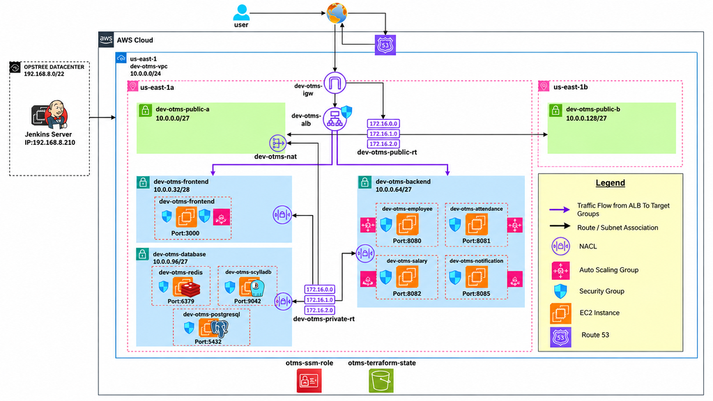

# AWS Network Skeleton Terraform Module (Design Documentation)

<p align="center">
  
  
  
  
</p>

---

# Author Table

| **Author** | **Created On** | **Version** | **Last Updated By** | **Last Edited On** | **L0 Reviewer** | **L1 Reviewer** | **L2 Reviewer** |
| :--- | :--- | :--- | :--- | :--- | :--- | :--- | :--- |
| **Anurag Maurya** | 19-11-2026 | 1.0 | Anurag Maurya | 19-11-2026 | Divya M / Vishal Tyagi | Aayush Verma | Mahesh Kumar / Varun |

---

# Table of Contents

1. [Objective](#1-objective)
2. [Prerequisites](#2-prerequisites)
3. [Module Design & Architecture](#3-module-design--architecture)
4. [Directory Structure](#4-directory-structure)
5. [Managed Resources](#5-managed-resources)
6. [Input Parameters](#6-input-parameters)
7. [Output Parameters](#7-output-parameters)
8. [Module Usage](#8-module-usage)
9. [Cost Allocation Tags](#9-cost-allocation-tags)
10. [Result](#10-result)
11. [Contact Information](#11-contact-information)
12. [References](#12-references)

---

# 1. Objective

Design a reusable, parameterized Terraform module to provision the foundational **3-tier AWS Network Skeleton** (VPC, Subnets, Gateways, Route Tables, and Route 53 DNS) for the OT-MS environment across multiple environments (`dev`, `staging`, `prod`) without code duplication.

---

# 2. Prerequisites

| **Requirement** | **Details** |
| :--- | :--- |
| **AWS Account** | Permissions for VPC, Subnets, Route Tables, IGW, NAT, Route 53 in `ap-south-1` |
| **Terraform CLI** | Version `>= 1.5.0` installed and configured |
| **IP Space** | Pre-allocated CIDR block (`10.0.0.0/24` or `10.0.0.0/16`) |

---

# 3. Module Design & Architecture

The module provisions a secure, 3-tier VPC architecture across multiple Availability Zones:

- **Public Tier (DMZ)**: Hosts NAT Gateway (`dev-otms-nat`) and Application Load Balancer (`dev-otms-alb`) connected to the Internet Gateway (`dev-otms-igw`).
- **Private Application Tier**: Hosts Frontend (Port 3000) and Backend Microservices (Employee: 8080, Attendance: 8081, Salary: 8082, Notification: 8085) with secure outbound internet via NAT.
- **Private Database Tier**: Isolated subnets hosting PostgreSQL (5432), ScyllaDB (9042), and Redis (6379) with local VPC routing only.
- **Route 53 DNS**: Private Hosted Zone (`dev.otms.internal`) for internal service discovery.

<p align="center">
  
</p>

### Subnet Segmentation Matrix

| Subnet Name | CIDR Block | Availability Zone | Tier | Routing |
| :--- | :--- | :--- | :--- | :--- |
| `dev-otms-public-a` | `10.0.0.0/27` | AZ-a | Public DMZ | `Internet Gateway` |
| `dev-otms-public-b` | `10.0.0.128/27` | AZ-b | Public DMZ | `Internet Gateway` |
| `dev-otms-frontend` | `10.0.0.32/28` | AZ-a | Private App | `NAT Gateway` |
| `dev-otms-backend` | `10.0.0.64/27` | AZ-a | Private App | `NAT Gateway` |
| `dev-otms-database` | `10.0.0.96/27` | AZ-a | Private DB | `Local VPC Only` |

---

# 4. Directory Structure

```text
Modules/Network_Skeleton/
├── README.md         # Module documentation
├── main.tf           # VPC, Subnets, IGW, NAT Gateway, EIP
├── routing.tf        # Route tables & subnet associations
├── nacls.tf          # 3-tier stateless Network ACLs
├── dns.tf            # Route 53 private & public hosted zones
├── variables.tf      # Parameterized inputs
├── outputs.tf        # Exported IDs & attributes
└── versions.tf       # Terraform & AWS provider requirements
```

---

# 5. Managed Resources

| **Resource** | **Type** | **Description** |
| :--- | :--- | :--- |
| [`aws_vpc`](https://registry.terraform.io/providers/hashicorp/aws/latest/docs/resources/vpc) | Resource | Base virtual cloud network with DNS hostnames enabled |
| [`aws_subnet`](https://registry.terraform.io/providers/hashicorp/aws/latest/docs/resources/subnet) | Resource | Multi-tier subnets (Public, Frontend, Backend, Database) |
| [`aws_internet_gateway`](https://registry.terraform.io/providers/hashicorp/aws/latest/docs/resources/internet_gateway) | Resource | Direct bidirectional internet communication for public subnets |
| [`aws_eip`](https://registry.terraform.io/providers/hashicorp/aws/latest/docs/resources/eip) | Resource | Elastic IP for NAT Gateway |
| [`aws_nat_gateway`](https://registry.terraform.io/providers/hashicorp/aws/latest/docs/resources/nat_gateway) | Resource | Outbound internet connectivity for private application subnets |
| [`aws_route_table`](https://registry.terraform.io/providers/hashicorp/aws/latest/docs/resources/route_table) | Resource | Routing rules (Public -> IGW, Private -> NAT, DB -> Local) |
| [`aws_route_table_association`](https://registry.terraform.io/providers/hashicorp/aws/latest/docs/resources/route_table_association) | Resource | Links subnets to designated route tables |
| [`aws_network_acl`](https://registry.terraform.io/providers/hashicorp/aws/latest/docs/resources/network_acl) | Resource | Stateless tiered firewalls for Public, Private App, and DB subnets |
| [`aws_route53_zone`](https://registry.terraform.io/providers/hashicorp/aws/latest/docs/resources/route53_zone) | Resource | Private (`dev.otms.internal`) & Public (`dev.otms.opstree.com`) zones |

---

# 6. Input Parameters

| **Name** | **Description** | **Type** | **Default** | **Required** |
| :--- | :--- | :--- | :--- | :---: |
| `name` | Prefix for resource names | `string` | `"dev-otms"` | **Yes** |
| `cidr_block` | VPC primary CIDR block | `string` | `"10.0.0.0/24"` | **Yes** |
| `availability_zones` | Target Availability Zones | `list(string)` | `["ap-south-1a", "ap-south-1b"]` | **Yes** |
| `public_subnets_cidr` | Public subnets CIDRs | `list(string)` | `["10.0.0.0/27", "10.0.0.128/27"]` | No |
| `frontend_subnets_cidr` | Frontend app subnet CIDR | `list(string)` | `["10.0.0.32/28"]` | No |
| `backend_subnets_cidr` | Backend services subnet CIDR | `list(string)` | `["10.0.0.64/27"]` | No |
| `database_subnets_cidr` | Database subnet CIDR | `list(string)` | `["10.0.0.96/27"]` | No |
| `enable_nat_gateway` | Provision NAT Gateway | `bool` | `true` | No |
| `single_nat_gateway` | Single NAT Gateway for cost optimization | `bool` | `true` | No |
| `enable_network_acl` | Provision dedicated 3-tier Network ACLs | `bool` | `true` | No |
| `enable_route53_private_zone` | Create Route 53 Private Zone | `bool` | `true` | No |
| `private_domain_name` | Private domain name | `string` | `"dev.otms.internal"` | No |
| `enable_route53_public_zone` | Create Route 53 Public Zone | `bool` | `true` | No |
| `public_domain_name` | Public domain name | `string` | `"dev.otms.opstree.com"` | No |
| `tags` | Cost allocation & metadata tags | `map(string)` | `{}` | **Yes** |

---

# 7. Output Parameters

| **Name** | **Description** |
| :--- | :--- |
| `vpc_id` | ID of the provisioned VPC |
| `vpc_cidr_block` | Primary CIDR block of the VPC |
| `public_subnet_ids` | List of public subnet IDs (for ALB & NAT) |
| `frontend_subnet_ids` | List of frontend subnet IDs (for React Frontend ASG) |
| `backend_subnet_ids` | List of backend subnet IDs (for API ASGs) |
| `database_subnet_ids` | List of database subnet IDs (for PostgreSQL, ScyllaDB, Redis) |
| `public_route_table_id` | ID of the public route table |
| `private_route_table_id` | ID of the private route table |
| `database_route_table_id` | ID of the database route table |
| `internet_gateway_id` | ID of the Internet Gateway |
| `nat_gateway_ids` | List of IDs of the NAT Gateways |
| `nat_public_ips` | List of Elastic IP addresses of the NAT Gateways |
| `public_nacl_id` | ID of the public subnets NACL |
| `private_app_nacl_id` | ID of the private application subnets NACL |
| `database_nacl_id` | ID of the database subnets NACL |
| `private_hosted_zone_id` | Zone ID of the Route 53 Private Hosted Zone |
| `public_hosted_zone_id` | Zone ID of the Route 53 Public Hosted Zone |

---

# 8. Module Usage

```hcl
provider "aws" {
  region = "ap-south-1"
}

module "network_skeleton" {
  source = "../../Modules/Network_Skeleton"

  name               = "dev-otms"
  cidr_block         = "10.0.0.0/24"
  availability_zones = ["ap-south-1a", "ap-south-1b"]

  public_subnets_cidr   = ["10.0.0.0/27", "10.0.0.128/27"]
  frontend_subnets_cidr = ["10.0.0.32/28"]
  backend_subnets_cidr  = ["10.0.0.64/27"]
  database_subnets_cidr = ["10.0.0.96/27"]

  enable_nat_gateway          = true
  single_nat_gateway          = true
  enable_network_acl          = true
  enable_route53_private_zone = true
  private_domain_name         = "dev.otms.internal"
  enable_route53_public_zone  = true
  public_domain_name          = "dev.otms.opstree.com"

  tags = {
    Name        = "OTMS-dev-network"
    Application = "OTMS-dev-network"
    Owner       = "Anurag"
    Environment = "dev"
    CostCenter  = "KubeClan-DevOps"
  }
}
```

---

# 9. Cost Allocation Tags

All resources adhere to the mandatory organizational cost allocation standards:

```hcl
tags = {
  Name        = "OTMS-dev-network"
  Application = "OTMS-dev-network"
  Owner       = "Anurag"
  Environment = "dev"
  CostCenter  = "KubeClan-DevOps"
}
```

---

# 10. Result

The Network Skeleton module provides a parameterized, reusable blueprint to instantiate the complete VPC network across `dev`, `staging`, and `prod` environments. It guarantees consistent 3-tier isolation, secure outbound connectivity, and internal DNS resolution without code duplication.

---

# 11. Contact Information

| **Name** | **Email** |
| :--- | :--- |
| **Anurag Maurya** | [anurag.maurya.snaatak@mygurukulam.co](mailto:anurag.maurya.snaatak@mygurukulam.co) |

---

# 12. References

| **Topic** | **Link** |
| :--- | :--- |
| **OT-CLOUD-KIT VPC Module** | [terraform-aws-vpc Template](https://github.com/OT-CLOUD-KIT/terraform-aws-vpc/blob/master/README.md) |
| **Terraform Modules** | [Creating Modules Guide](https://developer.hashicorp.com/terraform/language/modules/develop) |
| **AWS VPC Documentation** | [Amazon VPC User Guide](https://docs.aws.amazon.com/vpc/latest/userguide/what-is-amazon-vpc.html) |
