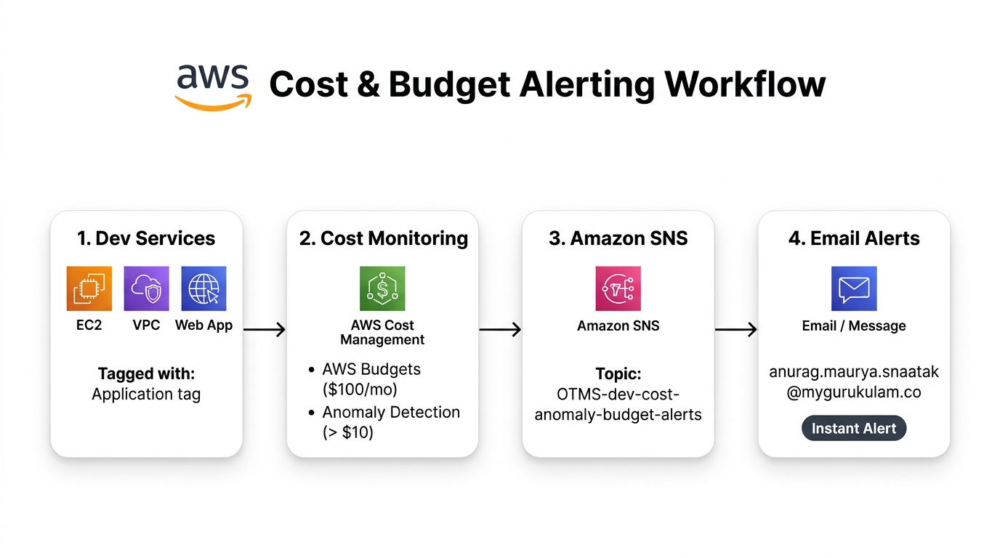

# AWS Budgets & Cost Anomaly Alerts (Static Terraform Infra)

<p align="center">
  
  
  
  
</p>

---

# Author Table

| **Author** | **Created On** | **Version** | **Last Updated By** | **Last Edited On** | **L0 Reviewer** | **L1 Reviewer** | **L2 Reviewer** |
| :--- | :--- | :--- | :--- | :--- | :--- | :--- | :--- |
| **Anurag Maurya** | 19-11-2026 | 1.0 | Anurag Maurya | 19-11-2026 | Divya M / Vishal Tyagi | Aayush Verma | Mahesh Kumar / Varun |

---

# Table of Contents

1. [Objective](#1-objective)
2. [Architecture & Alerting Flow](#2-architecture--alerting-flow)
3. [Directory Structure](#3-directory-structure)
4. [Managed Resources](#4-managed-resources)
5. [Tag-Based Service Filter Matrix](#5-tag-based-service-filter-matrix)
6. [Input Parameters](#6-input-parameters)
7. [Output Parameters](#7-output-parameters)
8. [Cost Allocation Tags](#8-cost-allocation-tags)
9. [CLI Execution & Validation Guide](#9-cli-execution--validation-guide)
10. [Reviewer Screenshots Checklist](#10-reviewer-screenshots-checklist)
11. [References](#11-references)

---

# 1. Objective

Implement static Terraform code to configure:
1. **Whole Account Budget**: Monthly cost budget with 80% actual, 100% actual, and 100% forecasted spending threshold alerts.
2. **Service-Level Budgets**: Dedicated budgets for each deployed microservice utilizing Cost Allocation Tag filters (`user:Application$<Service>`).
3. **AWS Cost Anomaly Detection**: Anomaly monitor and subscription sending daily anomaly alerts.
4. **Alert Notifications**: Multi-channel alerts delivering notifications via Amazon SNS and Email.

---

# 2. Architecture & Alerting Flow

<p align="center">
  
</p>

The architecture establishes a 3-stage FinOps monitoring pipeline:
1. **Workloads & Cost Allocation Tags**: All static dev services (Network, Attendance, ScyllaDB, Notification, Salary, Employee, Frontend) continuously stream tagged usage metrics.
2. **AWS Cost Management Layer**: Evaluates aggregate account limits ($100/mo) and tag-filtered service boundaries (`user:Application$<service>`), while Cost Anomaly Detection monitors daily spending anomalies with machine learning.
3. **Alerting Pipeline**: Fans out actionable alerts through Amazon SNS to subscribed team email endpoints.

---

# 3. Directory Structure

```text
Static_Dev/Cost_Optimization/AWS_Budgets/
├── README.md              # Documentation and execution guide
├── provider.tf            # Terraform and AWS provider configuration
├── variables.tf           # Parameterized inputs and service budget map
├── sns.tf                 # SNS Topic, Topic Policy, and Email Subscription
├── budgets.tf             # Whole Account & Tag-Filtered Service Budgets
├── anomaly_detection.tf   # Cost Anomaly Monitor & Subscription
└── outputs.tf             # Exported SNS, Budget, and Anomaly ARNs/IDs
```

---

# 4. Managed Resources

| **Resource** | **Type** | **Description** |
| :--- | :--- | :--- |
| [`aws_sns_topic.cost_alerts`](https://registry.terraform.io/providers/hashicorp/aws/latest/docs/resources/sns_topic) | Resource | Central SNS topic for cost and anomaly alert delivery |
| [`aws_sns_topic_policy.cost_alerts`](https://registry.terraform.io/providers/hashicorp/aws/latest/docs/resources/sns_topic_policy) | Resource | Grants `budgets.amazonaws.com` and `costalerts.amazonaws.com` publish permissions |
| [`aws_sns_topic_subscription.email_alert`](https://registry.terraform.io/providers/hashicorp/aws/latest/docs/resources/sns_topic_subscription) | Resource | Email subscription sending alerts to team email |
| [`aws_budgets_budget.whole_account`](https://registry.terraform.io/providers/hashicorp/aws/latest/docs/resources/budgets_budget) | Resource | Account-wide monthly budget ($100 USD) with 80% & 100% thresholds |
| [`aws_budgets_budget.services`](https://registry.terraform.io/providers/hashicorp/aws/latest/docs/resources/budgets_budget) | Resource | Tag-filtered budgets for each microservice |
| [`aws_ce_anomaly_monitor.service_monitor`](https://registry.terraform.io/providers/hashicorp/aws/latest/docs/resources/ce_anomaly_monitor) | Resource | Dimensional service monitor for detecting spend anomalies |
| [`aws_ce_anomaly_subscription.cost_anomaly_subscription`](https://registry.terraform.io/providers/hashicorp/aws/latest/docs/resources/ce_anomaly_subscription) | Resource | Daily anomaly alert subscription with threshold evaluation |

---

# 5. Tag-Based Service Filter Matrix

Each microservice budget filters costs dynamically using AWS Cost Allocation Tags:

| Service Name | Budget Name | Monthly Limit | Cost Filter Tag (`TagKeyValue`) |
| :--- | :--- | :--- | :--- |
| **Network Skeleton** | `OTMS-dev-network-service-budget` | $30.00 USD | `user:Application$OTMS-dev-network` |
| **Attendance App** | `OTMS-dev-attendance-service-budget` | $15.00 USD | `user:Application$attendance` |
| **Notification App** | `OTMS-dev-notification-service-budget` | $15.00 USD | `user:Application$notification` |
| **ScyllaDB** | `OTMS-dev-scylladb-service-budget` | $20.00 USD | `user:Application$scylladb` |
| **Salary App** | `OTMS-dev-salary-service-budget` | $15.00 USD | `user:Application$salary` |
| **Employee App** | `OTMS-dev-employee-service-budget` | $15.00 USD | `user:Application$employee` |
| **Frontend App** | `OTMS-dev-frontend-service-budget` | $15.00 USD | `user:Application$frontend` |

---

# 6. Input Parameters

| **Name** | **Description** | **Type** | **Default** | **Required** |
| :--- | :--- | :--- | :--- | :---: |
| `aws_region` | Target AWS deployment region | `string` | `"ap-south-1"` | No |
| `environment` | Deployment environment name | `string` | `"dev"` | No |
| `alert_email` | Alert email address | `string` | `"anurag.maurya.snaatak@mygurukulam.co"` | **Yes** |
| `account_budget_limit` | Whole account monthly budget in USD | `string` | `"100.0"` | No |
| `service_budgets` | Map of service budget limits & tag filters | `map(object)` | 7 Microservices Map | No |
| `anomaly_threshold_amount` | Anomaly alert USD impact threshold | `string` | `"10.0"` | No |
| `tags` | Standard cost allocation tags | `map(string)` | Standard Tags | **Yes** |

---

# 7. Output Parameters

| **Name** | **Description** |
| :--- | :--- |
| `sns_topic_arn` | ARN of the central Cost Alerts SNS Topic |
| `sns_topic_name` | Name of the central Cost Alerts SNS Topic |
| `whole_account_budget_name` | Name of the whole account budget |
| `whole_account_budget_id` | ID of the whole account budget |
| `service_budget_names` | Map of service budget names |
| `service_budget_ids` | Map of service budget IDs |
| `cost_anomaly_monitor_arn` | ARN of the Cost Anomaly Monitor |
| `cost_anomaly_subscription_arn` | ARN of the Cost Anomaly Subscription |

---

# 8. Cost Allocation Tags

All provisioned resources automatically adhere to mandatory organizational tagging standards:

```hcl
tags = {
  Name        = "OTMS-dev-cost-alerts"
  Application = "OTMS-dev-cost-optimization"
  Owner       = "Anurag"
  Environment = "dev"
  CostCenter  = "KubeClan-DevOps"
}
```

---

# 9. CLI Execution & Validation Guide

```bash
# 1. Navigate to the directory
cd "/mnt/c/Users/Administrator/Desktop/SOP's/Terraform/Static_Dev/Cost_Optimization/AWS_Budgets"

# 2. Format check
terraform fmt

# 3. Initialize
terraform init

# 4. Validate
terraform validate

# 5. Review Plan (13 resources to add)
terraform plan

# 6. Apply
terraform apply

# 7. Destroy (after demo/screenshots)
terraform destroy
```

---

# 10. Reviewer Screenshots Checklist

1. **Terminal Validation**: `terraform validate` (`Success! The configuration is valid.`).
2. **Terminal Plan**: `terraform plan` (`Plan: 13 to add, 0 to change, 0 to destroy.`).
3. **AWS Budgets Console**: **AWS Budgets** page showing:
   - `OTMS-dev-whole-account-budget` ($100.00 Limit)
   - 7 Service-level budgets (`OTMS-dev-network-service-budget`, `OTMS-dev-attendance-service-budget`, etc.).
4. **Tag Filter Verification**: Click any service budget ➔ Budget parameters showing Tag filter (`Tag: Application = ...`).
5. **Cost Anomaly Detection Console**: **Cost Anomaly Detection** ➔ Monitors tab showing `OTMS-dev-cost-anomaly-monitor`.
6. **SNS Topic & Subscription**: Amazon SNS Console ➔ Topics ➔ `OTMS-dev-cost-anomaly-budget-alerts` showing Email subscription.

---

# 11. References

| **Topic** | **Link** |
| :--- | :--- |
| **AWS Budgets Documentation** | [AWS Budgets User Guide](https://docs.aws.amazon.com/cost-management/latest/userguide/budgets-managing-costs.html) |
| **Cost Anomaly Detection** | [AWS Cost Anomaly Detection Guide](https://docs.aws.amazon.com/cost-management/latest/userguide/manage-ad.html) |
| **Terraform AWS Budgets** | [Terraform aws_budgets_budget](https://registry.terraform.io/providers/hashicorp/aws/latest/docs/resources/budgets_budget) |

